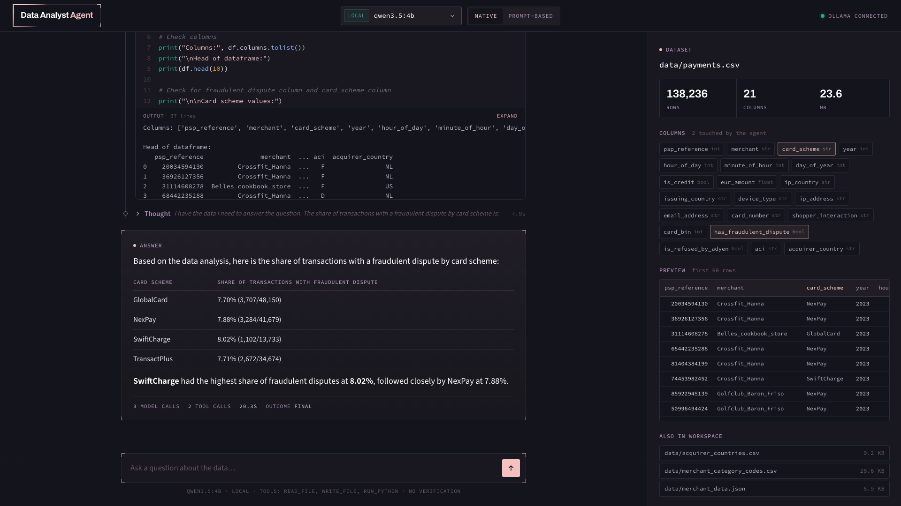

<div align="center">

# AI Agent from Scratch

**A data-analyst AI agent in plain Python. Free LLMs, no frameworks, about 700 lines you can read.**

It loads a real dataset, writes its own pandas code, runs it, reads the result, and keeps going
until it has an answer.

[](https://github.com/Harshithvarma007/ai-agent-from-scratch/actions/workflows/ci.yml)


[](LICENSE)
[](https://colab.research.google.com/github/Harshithvarma007/ai-agent-from-scratch/blob/main/notebook/agent_from_scratch.ipynb)

<!-- INTRO VIDEO: to make it play inline on GitHub, edit this README on github.com, drag
     docs/assets/intro.mp4 into the editor, and replace the <a> block below with the
     https://github.com/user-attachments/assets/... URL GitHub gives you. -->

https://github.com/user-attachments/assets/4e29a4e0-f0b7-4641-babb-94923a309b74


**▶ [Watch the 1-minute intro](docs/assets/intro.mp4)**: what an agent is, the loop, and the honest part.

</div>

---

## 🎬 The full build video

<!-- FULL VIDEO PLACEHOLDER: replace this block with the YouTube embed when it's live, e.g.
[](https://www.youtube.com/watch?v=VIDEO_ID)
-->

> **Coming soon.** The full, step-by-step video of this build goes here. Until then,
> [Build it](#-build-it-step-by-step) below walks the same eight steps in text, with the code and
> the real outputs.

---

## What it does

You ask a question about a CSV, in plain English. The agent decides what to look at, writes
pandas, runs it in a sandbox, reads what came back, and answers. This is a real run (`qwen3.5:4b` on local Ollama, long lines trimmed with `…`):

```text
$ python -m agent --yolo "Which merchant had the highest total eur_amount?"
[thought]
[action] read_file({'path': 'data/payments.csv'})
[observation] psp_reference,merchant,card_scheme,year,hour_of_day,minute_of_hour,day_of_year,is_credit,…
[thought]
[action] run_python({'code': "import pandas as pd\n\ndf = pd.read_csv('data/payments.csv')\nprint(df.columns.tolist())\nprint(df.head())"})
[observation] ['psp_reference', 'merchant', 'card_scheme', 'year', 'hour_of_day', 'minute_of_hour', …
[thought]
[action] run_python({'code': "import pandas as pd\n\ndf = pd.read_csv('data/payments.csv')\ntotal_by_merchant = df.groupby('merchant')['eur_amount'].s…
[observation] merchant
Crossfit_Hanna              5076636.90
Golfclub_Baron_Friso        2553380.62
Rafa_AI                     2544832.96
Belles_cookbook_store       1262219.80
Martinis_Fine_Steakhouse    1260227.18
Name: eur_amount, dtype: float64

[thought] Crossfit_Hanna had the highest total eur_amount at 5,076,636.90 EUR.

=== final ===
Crossfit_Hanna had the highest total eur_amount at 5,076,636.90 EUR.
```

That's correct (pandas agrees to the cent). It ships with a web UI that shows every step:

<p align="center"></p>

**What makes it different:**

- **From scratch.** No LangChain, no LlamaIndex, no LLM SDK. The agent itself is standard-library
  Python: one HTTP call, a decorator, a loop. Every line is yours to read.
- **Free.** Runs locally on [Ollama](https://ollama.com) (`qwen3.5:4b`, a 3.4 GB download), or on
  a free hosted tier (Gemini, Groq, OpenRouter). Switching is one flag.
- **Built to work on small models.** Small models are bad at tool calling, so every failure we hit
  has a fix in the loop, each one shown on a recorded real failure: silent replies, tool calls
  written as text, the model repeating itself.
- **Honest.** It's the *basic* agent: no verification. It will sometimes give a confident, wrong
  answer, and [docs/RESULTS.md](docs/RESULTS.md) measures exactly how often.
- **Production-shaped.** Installable package, CLI, web app, Docker, 75 tests, CI.

---

## Contents

- [Quick start](#-quick-start)
- [Setup, in detail](#-setup-in-detail)
- [Using it](#-using-it): CLI · web app · Python · Docker
- [**Build it, step by step**](#-build-it-step-by-step): the eight steps, with code and real output
- [How it works](#-how-it-works): the architecture in one picture
- [Safety](#-safety)
- [Project layout](#-project-layout)
- [Configuration](#-configuration)
- [Tests and CI](#-tests-and-ci)
- [Results](#-results)
- [Troubleshooting](#-troubleshooting)
- [Limitations, and what's next](#-limitations-and-whats-next)

---

## ⚡ Quick start

```bash
git clone https://github.com/Harshithvarma007/ai-agent-from-scratch.git
cd ai-agent-from-scratch
python3 -m venv .venv && source .venv/bin/activate
pip install -r requirements.txt -e .
python scripts/download_data.py          # the dataset, ~24 MB
ollama pull qwen3.5:4b                    # the model, ~3.4 GB (or use a free API key, below)
python -m agent "How many transactions are in data/payments.csv?"
```

No GPU or no Ollama? Use the Gemini free tier instead of the last two lines:

```bash
export GEMINI_API_KEY=...                 # free: https://aistudio.google.com/apikey
python -m agent --provider gemini "How many transactions are in data/payments.csv?"
```

---

## 🧰 Setup, in detail

### 1. Prerequisites

| You need | Version | Check |
|---|---|---|
| Python | 3.11 or newer (built on 3.12) | `python3 --version` |
| git | any | `git --version` |
| **One** model source | Ollama, **or** a free API key | see step 4 |
| Disk | ~4 GB for the local model, ~25 MB for the data | |
| RAM | 8 GB is enough for `qwen3.5:4b` | |

### 2. Clone and create a virtual environment

```bash
git clone https://github.com/Harshithvarma007/ai-agent-from-scratch.git
cd ai-agent-from-scratch
python3 -m venv .venv
source .venv/bin/activate              # Windows: .venv\Scripts\activate
```

> **Use a venv, not `pip install --user`.** The agent runs the model's pandas code in a
> subprocess with Python's isolated mode (`-I`), which ignores user site-packages. pandas must be
> installed *inside* the interpreter that runs the agent. See
> [Troubleshooting](#-troubleshooting).

### 3. Install

```bash
pip install -r requirements.txt -e .                 # exact versions we measured with
# or, for development (tests, lint, notebook tools):
pip install -r requirements.txt -e ".[dev,notebook]"
```

This installs the `agent` package and an `analyst-agent` command. The agent itself only uses the
standard library; pandas and numpy are there for the code *the model writes*.

### 4. Pick a model

**Option A: local, private, free (Ollama).** Recommended if you have 8 GB of RAM.

```bash
# macOS:   brew install ollama          (or download from https://ollama.com/download)
# Linux:   curl -fsSL https://ollama.com/install.sh | sh
# Windows: download from https://ollama.com/download
ollama serve                          # if it isn't already running as an app
ollama pull qwen3.5:4b                # the model this repo is tuned and measured on
```

If you'll ask long, multi-step questions, start Ollama with a bigger context window so the system
prompt (with the tool list) never gets silently cut off:

```bash
OLLAMA_CONTEXT_LENGTH=16384 ollama serve
```

Other models that work: `qwen3:8b`, `llama3.1:8b` (`--model qwen3:8b`).

**Option B: a free hosted tier.** No GPU needed. Set one key, then pass `--provider`:

| Provider | Get a key | Default model | Use it |
|---|---|---|---|
| Gemini | https://aistudio.google.com/apikey | `gemini-2.5-flash` | `export GEMINI_API_KEY=...` then `--provider gemini` |
| Groq | https://console.groq.com/keys | `openai/gpt-oss-20b` | `export GROQ_API_KEY=...` then `--provider groq` |
| OpenRouter | https://openrouter.ai/keys | `qwen/qwen3.8-27b:free` | `export OPENROUTER_API_KEY=...` then `--provider openrouter` |

Free-tier model names change often. If one is gone, pick a current one and pass `--model`. You can
also put your keys in a `.env` file (copy [`.env.example`](.env.example)) and load it with
`set -a; source .env; set +a`.

### 5. Get the data

```bash
python scripts/download_data.py
```

This downloads [DABstep](https://huggingface.co/datasets/adyen/DABstep) (Adyen, CC-BY-4.0) into
`workspace/data/` and checks each file's SHA-256, so your numbers match ours:

| File | What's in it |
|---|---|
| `payments.csv` | 138,236 card transactions × 21 columns (merchant, card scheme, `eur_amount`, fraud flags…) |
| `merchant_data.json` | 30 merchants and their account details |
| `merchant_category_codes.csv` | MCC code → description |
| `acquirer_countries.csv` | acquirer → country code |

### 6. Check everything works

```bash
python -m agent.config ollama              # prints the provider it would use
python -m agent.llm ollama "Say hi"        # one call to the model
python -m agent.tools                      # the tools, run by hand, no model
pytest                                     # 75 tests, no model or network needed (needs .[dev])
python -m agent --yolo "How many transactions are in data/payments.csv?"   # expect 138,236
```

Or with `make`: `make setup data model test run`.

---

## 🚀 Using it

### The CLI

```bash
python -m agent "What share of transactions had a fraudulent dispute, by card scheme?"
analyst-agent "..."                         # same thing, once installed
```

| Flag | Default | What it does |
|---|---|---|
| `--provider` | `ollama` (or `$AGENT_PROVIDER`) | `ollama` · `gemini` · `groq` · `openrouter` |
| `--model` | the provider's default | any model that provider serves |
| `--mode` | `native` | `native`: the provider's `tools=` API · `react`: the model replies with one JSON object per turn · `constrained`: `react` plus Ollama's grammar-constrained decoding |
| `--max-steps` | `10` | hard ceiling on think → act → observe turns |
| `--yolo` | off | skip the y/N prompt before `write_file` / `run_python` |
| `--sandbox` | `subprocess` | where `run_python` runs: `subprocess` or `docker` (see [Safety](#-safety)) |
| `--runs-dir` / `--no-save` | `runs/` | each run's full message history is saved as JSON |

Exit codes: `0` answered, `1` stopped without an answer (max steps, gave up), `2` couldn't reach the
model, `130` interrupted.

Without `--yolo`, the agent asks before running code:

```text
Allow run_python({'code': "import pandas as pd\ndf = pd.read_csv('data/payments.csv')..."})? [y/N]
```

### The web app

```bash
python webapp/server.py                    # http://localhost:8765  (PORT=... to change)
```

A thin UI over the exact same `run_agent()` loop: pick a model, choose native or prompt-based mode,
ask a question, and watch each model call, tool call and output stream in. The right-hand panel
previews the dataset. It binds to `127.0.0.1` only; it runs model-written code, so don't expose
it to a network.

### From Python

```python
from agent import ALL_TOOLS, Registry, get_provider, run_agent

result = run_agent(
    get_provider("ollama"),
    "How many distinct merchants are in data/payments.csv?",
    Registry(*ALL_TOOLS),
    trace=lambda kind, **info: print(kind, info.get("name", "")),
)
print(result["outcome"])   # "final" | "max_steps" | "gave_up"
print(result["answer"])
print(len(result["messages"]), "messages in the history")
```

Add your own tool in three lines; the decorator writes the JSON schema from the signature:

```python
from agent import tool, Registry, ALL_TOOLS

@tool()
def list_files(folder: str = "data") -> str:
    """List the files in a workspace folder."""
    import os
    return "\n".join(os.listdir(os.path.join("workspace", folder)))

registry = Registry(*ALL_TOOLS, list_files)
```

### Docker

```bash
docker compose up --build                            # web app + Ollama, http://localhost:8765
docker compose exec ollama ollama pull qwen3.5:4b    # first run only; the model persists
```

Or with a free API key and no Ollama container:
`docker build -t ai-agent-from-scratch . && docker run -p 127.0.0.1:8765:8765 -e AGENT_PROVIDER=gemini -e GEMINI_API_KEY=$GEMINI_API_KEY ai-agent-from-scratch`.
The image downloads the dataset at build time, runs as a non-root user, and has a health check.

---

## 🛠 Build it, step by step

This is the heart of the repo: the agent, built in **eight small steps**, run after every one. Each
step adds one idea. You can follow along three ways. They're the same code, so pick one:

| Way | Where | Best for |
|---|---|---|
| **The notebook** | [`notebook/agent_from_scratch.ipynb`](notebook/agent_from_scratch.ipynb) | reading and running it top to bottom, one cell per idea ([Colab](https://colab.research.google.com/github/Harshithvarma007/ai-agent-from-scratch/blob/main/notebook/agent_from_scratch.ipynb)) |
| **The step files** | [`steps/loop_step1.py`](steps/loop_step1.py) … [`loop_step8.py`](steps/loop_step8.py) | running each checkpoint from a terminal |
| **The video** | [above](#-the-full-build-video) | watching it built and explained |

The finished, production version is [`agent/`](agent/). The [end of this section](#from-notebook-to-package)
maps each step to the file it became.

```bash
pip install -e ".[notebook]"
jupyter lab notebook/agent_from_scratch.ipynb      # then Kernel → Restart & Run All
```

> Always **Restart & Run All**. The notebook redefines `run_agent` at each step, so running cells
> out of order gives you an older step's loop.

### The goal

By the end, this question:

> *What is the total `eur_amount` across all transactions in `data/payments.csv`? Round to 2 decimal places.*

gets the right answer (**12,697,297.46**, which you can check with one line of pandas) from a
4-billion-parameter model that has never seen the file.

### Step 0: one call to a model

Everything starts with one HTTP request. Every provider here (Ollama, Gemini, Groq, OpenRouter)
speaks the same OpenAI-compatible `/chat/completions` API, so this is the entire LLM client
([`steps/hello_llm.py`](steps/hello_llm.py)):

```python
import json, os, urllib.request

def ask(base_url, api_key, model, question):
    body = {"model": model, "messages": [{"role": "user", "content": question}]}
    req = urllib.request.Request(
        base_url.rstrip("/") + "/chat/completions",
        data=json.dumps(body).encode(), method="POST",
        headers={"Content-Type": "application/json", "Authorization": f"Bearer {api_key}"},
    )
    with urllib.request.urlopen(req) as r:
        return json.loads(r.read())["choices"][0]["message"]["content"]
```

Switching providers is just a different `base_url`, key and model name. That's why
[`agent/config.py`](agent/config.py) is one dictionary of presets, and why every other file is
provider-agnostic. The production [`agent/llm.py`](agent/llm.py) adds three things: retries on
`429`/`5xx` (never on a plain bad answer, since greedy decoding would return the same thing),
recovery of Groq's `tool_use_failed` errors, and Ollama's grammar-constrained mode.

### Step 1: one call. Still a chatbot.

[`steps/loop_step1.py`](steps/loop_step1.py) · notebook cells `s1-*`

Give the model a system prompt that describes the data, ask the question, print the reply:

```python
messages = [{"role": "system", "content": DATA_CONTEXT},
            {"role": "user", "content": task}]
msg = llm.chat(provider, messages)
print(msg["content"])
```

```bash
python steps/loop_step1.py
```

What you'll see (real output): the model *describes* what it would do.

```text
Let me first inspect the payments.csv file to understand its structure and column names.

```python
df = pd.read_csv('data/payments.csv')
print(df.columns)
...
```

It knows pandas. It even writes the right code. But **nothing runs.** An LLM only produces text;
it can't open the file. That's the whole difference between a chatbot and an agent.

### Step 2: offer tools. The model asks; nothing runs yet.

[`steps/loop_step2.py`](steps/loop_step2.py) · cells `s2-*`

A tool is a normal Python function plus a description the model reads: its **schema**. Writing
schemas by hand is tedious and drifts out of sync with the code, so a decorator builds it from the
function's own signature ([`agent/tools.py`](agent/tools.py)):

```python
def tool(*, dangerous=False):
    def wrap(fn):
        props, required = {}, []
        for name, p in inspect.signature(fn).parameters.items():
            props[name] = _schema_for_param(p.annotation)        # str -> "string", int -> "integer"…
            if p.default is inspect.Parameter.empty:
                required.append(name)
        doc = (fn.__doc__ or "").strip()
        fn.schema = {"type": "function", "function": {
            "name": fn.__name__,
            "description": doc.splitlines()[0] if doc else fn.__name__,   # the model reads this
            "parameters": {"type": "object", "properties": props, "required": required},
        }}
        fn.dangerous = dangerous
        return fn
    return wrap


@tool()
def read_file(path: str) -> str:
    """Read a text file from the workspace directory and return its contents..."""

@tool(dangerous=True)
def run_python(code: str) -> str:
    """Run a Python snippet (pandas/numpy available) against files in the workspace..."""
```

Now send the schemas with the request (`tools=registry.schemas`):

```bash
python steps/loop_step2.py
```

Real output: the reply has **no text**, just a structured request:

```text
content:    ''
tool_calls: [
  {
    "id": "call_y4g99oek",
    "type": "function",
    "function": {
      "name": "read_file",
      "arguments": "{\"path\":\"data/payments.csv\"}"
    }
  }
]
```

The model doesn't run anything. It *asks* you to. Running it is your code's job. (Want to feel
this with no code at all? [`steps/demo/`](steps/demo/) has two `curl` requests where you play the
part of the program.)

### Step 3: run the tool call

[`steps/loop_step3.py`](steps/loop_step3.py) · cells `s3-*`

Two rules, and most broken agents break one of them:

1. Append the model's request (`role: "assistant"`, with its `tool_calls`) to the history **first**.
2. Then append each result as `role: "tool"`, with the matching `tool_call_id`.

```python
messages.append({"role": "assistant", "content": content, "tool_calls": calls})
for c in calls:
    name = c["function"]["name"]
    args = json.loads(c["function"]["arguments"])
    result = registry.run(name, args)
    messages.append({"role": "tool", "tool_call_id": c.get("id", name), "content": result})
```

`Registry.run()` **never raises.** An unknown tool, a missing argument or a crash in the tool all
come back as an `"Error: ..."` string, which the model reads as its next observation and can
recover from. It also coerces `"3"` to `3` and `"true"` to `True`, because small models send
strings.

### Step 4: the loop

[`steps/loop_step4.py`](steps/loop_step4.py) · cells `s4-*`

Do step 3 again and again. Stop when the reply has no tool call: that's the model answering.

```python
# condensed from steps/loop_step4.py
def run_agent(task):
    messages = [{"role": "system", "content": DATA_CONTEXT},
                {"role": "user", "content": task}]
    while True:
        msg = llm.chat(provider, messages, tools=registry.schemas)    # think
        content, calls = msg.get("content") or "", msg.get("tool_calls")
        if not calls:
            return content                                            # done
        messages.append({"role": "assistant", "content": content, "tool_calls": calls})
        for c in calls:                                               # act
            result = registry.run(c["function"]["name"], json.loads(c["function"]["arguments"]))
            messages.append({"role": "tool", "tool_call_id": c.get("id"), "content": result})  # observe
            # (the real file also prints each [action] and [observation] as it goes)
```

```bash
python steps/loop_step4.py
```

Real output (from the notebook's saved run):

```text
[action] read_file({'path': 'data/payments.csv'})
[observation] psp_reference,merchant,card_scheme,year,hour_of_day,minute_of_hour,day_of_year,...
[action] run_python({'code': 'import pandas as pd\n\ndf = pd.read_csv(\'data/payments.csv\')\ntotal = df[\'eur_amount\'].sum()\n...'})
[observation] Total eur_amount: 12697297.459999999
Rounded to 2 decimal places: 12697297.46

[thought] The total eur_amount across all transactions in data/payments.csv is **12,697,297.46**.

=== final ===
The total eur_amount across all transactions in data/payments.csv is **12,697,297.46**.
```

**That's an agent:** an LLM, tools, and a loop. Everything after this step is about making it
survive real models.

### Step 5: a hard ceiling

[`steps/loop_step5.py`](steps/loop_step5.py) · cells `s5-*`

`while True` is a promise you can't keep. A model that keeps calling tools would loop (and bill
you) forever. One line fixes it:

```python
for step in range(MAX_STEPS):        # was: while True
    ...
return "Stopped: reached max_steps without a final answer."
```

### Step 6: when the model goes silent

[`steps/loop_step6.py`](steps/loop_step6.py) · cells `s6-*`

Sometimes a small model replies with **no text and no tool call**. Step 4's rule ("no tool call
means it's answering") turns that into a blank final answer. It happened in about 1 run in 9 on
`qwen3.5:4b`, so we recorded a real one and replay it. The model's replies come from the
recording; the tools run for real:

```bash
python steps/replay.py steps/traces/silent_reply.json steps/loop_step4.py    # before
python steps/replay.py steps/traces/silent_reply.json steps/loop_step6.py    # after
```

```text
# before (step 4)                       # after (step 6)
[thought]                               [thought]
                                        [error] empty reply with no tool call -- asking again
=== final ===                           [thought] Based on the acquirer_countries.csv file, the
                                          acquirer 'gringotts' is based in country code **GB**
                                        === final ===
                                        Based on the acquirer_countries.csv file, ... **GB** ...
```

The fix: treat silence as an error, say so, and ask again, at most three times in a row:

```python
if not calls:
    if content.strip():
        return content
    consecutive_errors += 1
    if consecutive_errors >= MAX_CONSECUTIVE_ERRORS:
        return "Stopped: model kept replying with nothing."
    messages.append({"role": "user", "content": "Error: empty reply with no tool call. "
                     "Call a tool, or give your final answer as plain text."})
    continue
```

This one bug fix changed our benchmark: native tool calling went from *losing* to prompt-based
mode to *winning* (see [Results](#-results)).

### Step 7: when the tool call arrives as text

[`steps/loop_step7.py`](steps/loop_step7.py) · cells `s7-*`

Another small-model habit: writing the tool call into the *text* instead of `tool_calls`.
An illustrative reply of that shape:

```text
I will look at the file first. {"tool": "read_file", "args": {"path": "data/acquirer_countries.csv"}}
```

Before treating text as the final answer, look for a JSON tool call hiding in it.
`extract_json()` ([`agent/agent.py`](agent/agent.py)) finds the first balanced `{...}`, skipping
`<think>` blocks and braces inside strings. It's a 30-line version of what a package like
`json_repair` does:

```python
if not calls:
    rescued = extract_json(content)
    if rescued and "tool" in rescued:
        calls = [{"function": {"name": rescued["tool"], "arguments": rescued.get("args", {})}}]
    elif content.strip():
        return content
```

### Step 8: when it repeats itself

[`steps/loop_step8.py`](steps/loop_step8.py) · cells `s8-*`

Last failure: the model calls **the same tool with the same arguments**, over and over. Here a real
`llama3.1:8b` run keeps sending the same broken one-liner (its `with` statement can't follow a
`;`, so it's a `SyntaxError` every time):

```bash
python steps/replay.py steps/traces/repeat_guard.json steps/loop_step8.py
```

```text
[loop guard] refused to repeat run_python({'code': "import json; with open('data/merchant_data.json') ..."})
[loop guard] refused to repeat run_python({'code': "import json; with open('data/merchant_data.json') ..."})
[replay] end of recording: the real run stopped here (max_steps)
```

The guard counts each `(tool, arguments)` pair. After the third identical call, it refuses and
tells the model why, so the model can try something else:

```python
def execute(name, args, seen_calls):
    key = (name, json.dumps(args, sort_keys=True, default=str))
    seen_calls[key] = seen_calls.get(key, 0) + 1
    if seen_calls[key] > REPEAT_THRESHOLD:
        return "Error: you already called this exact tool with these exact arguments. Try something else."
    return truncate(registry.run(name, args))
```

`truncate()` keeps the head and tail of long outputs, so one huge `print(df)` can't flood the
context window. **This is the finished loop.** Run it live:

```bash
python steps/loop_step8.py
python steps/loop_step8.py "How many distinct merchants are in data/payments.csv?"
```

### From notebook to package

Every step lives on in [`agent/`](agent/). The package adds what a notebook hides:

| Step / cells | Became | What production adds |
|---|---|---|
| Step 0 (`setup-provider`, `setup-chat`) | [`config.py`](agent/config.py), [`llm.py`](agent/llm.py) | four providers, API-key checks, retries on 429/5xx, Groq recovery, Ollama's constrained mode |
| Step 2 (`s2-*`) | [`tools.py`](agent/tools.py) | `@tool(dangerous=...)`, the `Registry`, argument coercion, the workspace jail, a scrubbed subprocess, confirmation before dangerous tools |
| Steps 4–8 (`s4-*` … `s8-*`) | [`agent.py`](agent/agent.py) | prompt-based (ReAct) and constrained modes, history trimming, a trace callback the web app streams |
| (none) | [`main.py`](agent/main.py) | the CLI, the coloured trace, saved trajectories, exit codes |
| (none) | [`sandbox_ladder.py`](agent/sandbox_ladder.py) | the Docker sandbox, and the demo of why `exec()` isn't one |

Same eight ideas, same order. Read `agent/agent.py` now and every line should look familiar.

### Native vs prompt-based tool calling

`--mode native` uses the provider's `tools=` API (steps 2–8). `--mode react` sends **no** `tools=`.
The tool list goes into the system prompt instead, and the model must reply with exactly one JSON
object per turn:

```text
{"thought": "...", "tool": "run_python", "args": {"code": "..."}}
{"thought": "...", "tool": "final_answer", "args": {"answer": "12,697,297.46"}}
```

This works with *any* model, even ones with no tool-calling support. `--mode constrained` adds
Ollama's `format=` grammar, which makes invalid JSON and made-up tool names impossible to
generate. Which mode wins depends on your model and task: measure it
([`bench/`](bench/)), don't assume.

### Try it yourself

1. Add a `describe_columns(path)` tool that returns `df.dtypes` and null counts. Does the model use it?
2. Ask the trap question: `python -m agent "What is the total eur_amount for merchant 'Zorblax_Fitness'?"` That merchant doesn't exist. What does your model say?
3. Run the same question in `--mode native` and `--mode react` five times each. Which is more reliable for you?
4. Compare against a framework: [`comparisons/langchain/`](comparisons/langchain/) and [`comparisons/langgraph/`](comparisons/langgraph/) build the same agent in 17–20 lines, on top of ~170,000 lines of dependencies.

---

## 🧠 How it works

```text
            ┌──────────────────────────── run_agent() ─────────────────────────────┐
 question → │  messages = [system: data context + rules, user: question]           │
            │                                                                      │
            │  for step in range(max_steps):                                       │
            │     reply = llm.chat(messages, tools=schemas)        ← THINK         │
            │     no tool call?  → text: done ✓ · empty: ask again · JSON: rescue  │
            │     for each call: guard repeats → confirm if dangerous              │
            │                    → registry.run(name, args)        ← ACT           │
            │                    → append result (truncated)       ← OBSERVE       │
            │     trim oldest whole steps if history is too long                   │
            └──────────────────────────────────────────────────────────────────────┘
                     │                                      │
          llm.py: one HTTP POST to any         tools.py: read_file · write_file · run_python
          OpenAI-compatible endpoint           jailed to workspace/ · subprocess sandbox
```

| File | Lines | Job |
|---|---|---|
| [`agent/config.py`](agent/config.py) | ~70 | provider presets: Ollama, Gemini, Groq, OpenRouter |
| [`agent/llm.py`](agent/llm.py) | ~70 | `chat()`: one call to any OpenAI-compatible endpoint, with retries |
| [`agent/tools.py`](agent/tools.py) | ~185 | `@tool`, `Registry`, and the three data tools |
| [`agent/agent.py`](agent/agent.py) | ~210 | the loop, both modes, every reliability fix |
| [`agent/main.py`](agent/main.py) | ~100 | the CLI |
| [`agent/sandbox_ladder.py`](agent/sandbox_ladder.py) | ~65 | the Docker sandbox, and the `exec()` counter-example |

---

## 🔒 Safety

The agent runs code an LLM wrote, against your files. Here's what stands between the two:

- **Workspace jail.** Every path is resolved (`realpath`, so symlinks and `../` can't escape) and
  must stay inside `workspace/`.
- **Confirmation.** `write_file` and `run_python` are `dangerous=True`: the CLI asks y/N first
  unless you pass `--yolo`. The web app runs with no confirmation, which is one reason it binds to
  localhost only.
- **Subprocess sandbox (default).** `run_python` runs `python -I -c <code>` in a separate process
  with a timeout, `cwd` set to the workspace, and an environment scrubbed to just `PATH`. Your API
  keys aren't visible to it. It does **not** stop the code from reading other files or using the
  network.
- **Docker sandbox (`--sandbox docker`).** No network, no capabilities, `--user nobody`, 512 MB RAM,
  100 processes, workspace mounted read-only. For pandas inside it, build the sandbox image:

  ```bash
  docker build -f Dockerfile.sandbox -t analyst-agent-sandbox .
  AGENT_DOCKER_IMAGE=analyst-agent-sandbox python -m agent --sandbox docker "..."
  ```

See the difference yourself. `python -m agent.sandbox_ladder` runs a "leak the API key" snippet
through `exec()` and through the subprocess sandbox:

```text
rung 0 (exec, bad)       : sk-totally-secret-demo-key
rung 1 (subprocess, ok)  : not visible
```

**Don't** point this at data you can't afford to lose, run it as root, or expose the web app to the
internet.

---

## 📁 Project layout

```text
ai-agent-from-scratch/
├── agent/                    the agent: an installable package (stdlib only)
│   ├── config.py  llm.py  tools.py  agent.py  main.py  sandbox_ladder.py
│   └── __main__.py           `python -m agent`
├── notebook/
│   ├── agent_from_scratch.ipynb   the 8-step build, with real outputs
│   ├── build_notebook.py          generates the .ipynb (edit cells here, not in the notebook)
│   └── run_notebook.py            executes it top to bottom; fails on any error
├── steps/                    the same 8 steps as runnable scripts
│   ├── hello_llm.py  loop_step1.py … loop_step8.py
│   ├── replay.py + traces/   recorded real failures, replayed on demand
│   └── demo/                 one tool call by hand, with curl
├── webapp/                   UI over run_agent(): server.py (stdlib) + static/
├── scripts/download_data.py  fetches + verifies the dataset
├── workspace/                the agent's jail; data lands in workspace/data/
├── bench/                    golden questions + the harness behind docs/RESULTS.md
├── comparisons/              the same agent in LangChain and in LangGraph
├── tests/                    75 tests: unit, CLI, web app, replays, notebook sync
├── docs/                     RESULTS.md + README assets
├── Dockerfile  docker-compose.yml  Dockerfile.sandbox
├── pyproject.toml  requirements.txt  requirements-dev.txt  Makefile  .env.example
└── .github/workflows/ci.yml
```

---

## ⚙️ Configuration

Every setting is an environment variable (see [`.env.example`](.env.example)) or a CLI flag.

| Variable | Default | Meaning |
|---|---|---|
| `AGENT_PROVIDER` | `ollama` | default provider for the CLI, steps and notebook |
| `AGENT_MODEL` | per provider | override the model |
| `GEMINI_API_KEY` / `GROQ_API_KEY` / `OPENROUTER_API_KEY` | | free-tier keys |
| `OLLAMA_HOST_URL` | `http://localhost:11434` | where Ollama is (Compose sets `http://ollama:11434`) |
| `AGENT_WORKSPACE` | `./workspace` | the directory the tools are jailed to |
| `AGENT_SANDBOX` | `subprocess` | `subprocess` or `docker` |
| `AGENT_DOCKER_IMAGE` | `python:3.12-slim` | image for the Docker sandbox |
| `AGENT_RUN_PYTHON_TIMEOUT` | `25` | seconds before `run_python` is killed |
| `AGENT_RUNS_DIR` | `./runs` | where trajectories are saved |
| `HOST` / `PORT` | `127.0.0.1` / `8765` | web app address |

---

## ✅ Tests and CI

```bash
pip install -e ".[dev]"
pytest                    # 75 tests, ~6 s, no model and no network needed
pytest -m data            # also replay the recorded runs on the real dataset (needs scripts/download_data.py)
ruff check .
```

The tests use a scripted fake model, so they cover the loop's real behaviour deterministically:
tool calls, silent replies, rescued text calls, the repeat guard, max steps, confirmation,
ReAct and constrained modes, the jail (including symlink escapes), the sandbox's scrubbed
environment, timeouts, retries, the CLI's exit codes, and the web app's streaming endpoint. One
test fails if `notebook/agent_from_scratch.ipynb` drifts from its generator.

CI ([`.github/workflows/ci.yml`](.github/workflows/ci.yml)) runs lint and tests on Python 3.11,
3.12 and 3.13, replays the recorded runs against the real dataset, and builds the Docker image.

To regenerate the notebook after editing a cell in `notebook/build_notebook.py`:

```bash
python notebook/build_notebook.py && python notebook/run_notebook.py   # needs Ollama or a free key
```

---

## 📊 Results

Measured on this code, with free local models, 3 runs per question. Full tables and method:
[docs/RESULTS.md](docs/RESULTS.md).

| | |
|---|---|
| `qwen3.5:4b`, 11 golden questions, native mode | **91%** correct (30/33 runs), ~18 s per question |
| same, prompt-based (ReAct) mode | **85%** (28/33) |
| The trap question (a merchant that doesn't exist) | **0 of 18** runs said so. All 18 answered with a number, across 3 models and both modes. |
| LangChain's pandas agent, same model and questions | 91% (default) / 82% (`tool-calling`), on ~170k lines of dependencies |

The trap result is the point: an agent that *runs* isn't an agent you can *trust*.

---

## 🩺 Troubleshooting

| Symptom | Cause and fix |
|---|---|
| `ModuleNotFoundError: No module named 'pandas'` inside `run_python` | `run_python` uses `python -I`, which ignores `pip install --user` packages. Use a venv and install pandas into it: `pip install -r requirements.txt`. |
| `error: could not reach ollama ... Is Ollama running?` | Start it: `ollama serve` (or open the Ollama app). Check with `curl localhost:11434/api/version`. |
| `model "qwen3.5:4b" not found` (HTTP 404) | `ollama pull qwen3.5:4b`, or pass the model you have: `--model llama3.1:8b` (`ollama list`). |
| The agent "forgets" its tools mid-run | Ollama silently truncated the start of the context, where the system prompt and tool list live. Run `OLLAMA_CONTEXT_LENGTH=16384 ollama serve`. |
| `provider 'gemini' needs an API key` | `export GEMINI_API_KEY=...` in the same shell (or load your `.env`). |
| HTTP 429 from a free tier | Rate limit. `llm.py` already retries with backoff; wait a minute, or switch provider. |
| A free-tier model returns 404 | Free model names change. Pick a current one and pass `--model`. |
| `run_python timed out after 25s` | Raise `AGENT_RUN_PYTHON_TIMEOUT`, or ask a narrower question. |
| `--sandbox docker` errors | Docker isn't running, or the image lacks pandas. Start Docker and build `Dockerfile.sandbox` (see [Safety](#-safety)). |
| `No dataset yet` / `no such file: data/payments.csv` | `python scripts/download_data.py`, and run commands from the repo root. |
| Ollama ignores `tool_choice` | Expected: Ollama's `/v1` endpoint can't force a tool call. The loop is built around that. |
| Notebook gives odd results | Kernel → **Restart & Run All**. Cells redefine `run_agent` step by step. |

---

## 🧭 Limitations, and what's next

This is deliberately the **basic** agent. It has no data profiling, no verification of its own
answers, and no record of what it has already established. That's why it can answer `0` for a
merchant that doesn't exist. Making it trustworthy (profiling, checks, provenance, asking when a
question doesn't fit the data) is the sequel, built on this exact code.

Contributions are welcome: open an issue first for anything bigger than a fix. Run `pytest` and
`ruff check .` before a pull request.

---

## Credits

- **Dataset:** [DABstep](https://huggingface.co/datasets/adyen/DABstep) by Adyen, CC-BY-4.0.
- **Fonts** in the web app: Archivo, Source Sans 3, Source Code Pro (SIL Open Font License).
- **Ideas borrowed, with thanks:** OpenAI's "function to schema" cookbook pattern (the `@tool`
  decorator), smolagents' Docker sandbox flags.

## License

[MIT](LICENSE) © 2026 N Sai Harshith Varma
